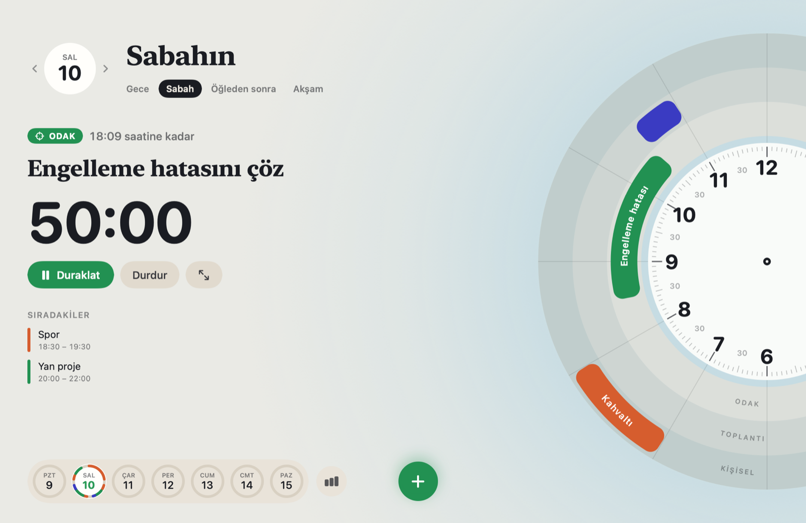

<!--
  docs/screenshot.png does not exist yet; add a real screenshot before publishing.
-->

# Odak

Odak (Turkish for "focus") is a free macOS menu bar timer that blocks distracting websites and hides distracting apps while a focus session is running. It also has a simple day planner and an optional full-screen focus screen.



*Screenshot to be added.*

## Why

I wanted a timer that lives in the menu bar, starts in one click, and makes YouTube and X unreachable for the next 25 minutes without asking me to sign up for anything. Nothing I tried did exactly that, so I wrote it for myself. It is small on purpose.

Freedom, Cold Turkey, SelfControl and Opal are more mature and some are harder to get around. Odak trades that strength for simplicity: blocking only lasts as long as the session, and you can always stop it. If you need a lock you cannot undo, use one of those.

## Install

With Homebrew:

```sh
brew install --cask slymnyg/tap/odak
```

Or download the latest `Odak-<version>.zip` from the [Releases](https://github.com/slymnyg/odak/releases) page, unzip it, and move `Odak.app` to `/Applications`.

Requires macOS 14 Sonoma or later.

If a release is not notarized, macOS will refuse to open it the first time. Right-click `Odak.app` in Finder, choose Open, then confirm. On macOS 15 and later, open it once, then go to System Settings > Privacy & Security and click Open Anyway. Or remove the quarantine flag yourself:

```sh
xattr -dr com.apple.quarantine /Applications/Odak.app
```

## How blocking works

Website blocking edits `/etc/hosts`. Writing to that file needs root, so Odak installs a small shell script that does only that.

Website blocking needs a one-time setup. When you click Install Helper (in the menu bar popover or in Settings > Blocking), Odak asks for your admin password once and installs two files:

| File | Owner, mode | Purpose |
| --- | --- | --- |
| `/Library/PrivilegedHelperTools/app.odak.block` | root:wheel, 755 | The helper. Accepts `on <domains...>`, `off` or `status`. |
| `/etc/sudoers.d/app_odak` | root:wheel, 440 | Lets your user run that one helper without a password. |

The sudoers file contains a single line (with your username):

```
yourname ALL=(root) NOPASSWD: /Library/PrivilegedHelperTools/app.odak.block
```

It allows that one path and nothing else. The file is checked with `visudo -cf` before it is installed. The name has no dot because sudo ignores files in `/etc/sudoers.d` whose names contain one.

When a session starts, Odak runs `sudo -n /Library/PrivilegedHelperTools/app.odak.block on youtube.com x.com ...`. The helper:

1. Refuses to run if any argument is not a plain lowercase domain name (strict regex, max 253 characters).
2. Writes a copy of `/etc/hosts` without any previous Odak section.
3. Appends a new section between two marker lines, pointing each domain to `0.0.0.0` and `::`. Odak also adds the `www.`, `m.` and `mobile.` variants.
4. Moves the new file over `/etc/hosts` in one step, so the file is never left half written.
5. Flushes the DNS cache (`dscacheutil -flushcache`, `killall -HUP mDNSResponder`).

```
# >>> ODAK BLOCK
0.0.0.0 youtube.com
:: youtube.com
...
# <<< ODAK BLOCK
```

Nothing outside the markers is changed. The section is removed when the session ends or is stopped, when you quit Odak, and on the next launch if Odak crashed while blocking.

Browsers get a second layer. Chrome and others often resolve names themselves ("secure DNS") or keep a connection open, and then never look at `/etc/hosts`. So during a session Odak also checks the tabs of Safari, Chrome, Dia, Arc, Brave, Edge and Vivaldi every two seconds and sends any tab on a blocked site, or one of its subdomains, to a local "blocked" page. macOS asks once per browser whether Odak may control it (System Settings > Privacy & Security > Automation). Odak reads tab addresses only to compare them with your list; nothing is stored or sent anywhere.

App blocking needs no privileges. Odak hides the apps you chose while a session is running. It does not quit them, so you lose no work.

### Why hosts and not a network extension

A Network Extension content filter would be harder to bypass, but it requires a paid Apple developer account, specific entitlements, and a system extension the user must approve in System Settings. The hosts file works with every browser, needs no entitlements, and is easy to inspect and undo by hand. For a free open-source app that seemed like the right trade.

### Limitations

- Connections that are already open may keep working until the page is reloaded or the browser drops them. Browsers also keep their own DNS cache for a minute or so.
- Browsers or apps that do their own DNS (DNS over HTTPS, "secure DNS") skip `/etc/hosts`. The tab check covers this for the browsers listed above once you allow it. Firefox cannot be scripted this way, so there you need to turn secure DNS off.
- The tab check runs every two seconds, so a blocked page can show briefly before it is turned away.
- Some VPNs and proxies resolve names themselves and bypass the hosts file.
- Blocking works by domain name only. Visiting a site by IP address is not blocked.
- You can stop a session at any time, which ends blocking. This is a nudge, not a lock.

### Removing everything by hand

If you want to undo blocking or remove the helper without the app:

```sh
# Clear the Odak section from /etc/hosts
sudo /Library/PrivilegedHelperTools/app.odak.block off

# If the helper is already gone, remove the section directly
sudo sed -i '' '/^# >>> ODAK BLOCK$/,/^# <<< ODAK BLOCK$/d' /etc/hosts
sudo dscacheutil -flushcache; sudo killall -HUP mDNSResponder

# Remove the helper and the sudoers rule
sudo rm -f /Library/PrivilegedHelperTools/app.odak.block /etc/sudoers.d/app_odak
```

## Usage

- Click the Odak icon in the menu bar. Pick a length (15, 25, 45, 60 or 90 minutes, or a custom one) and press Start Focus.
- Optionally type what you want to get done. It stays visible during the session.
- The remaining time is shown in the menu bar, for example `◎ 24:13`.
- When a focus session starts, a full-screen focus screen covers the main display and hides the Dock and the menu bar. It shows the countdown, your intention, and Pause, End and Hide buttons. Press Esc to return to the menu bar, and Show Focus Screen in the menu to bring it back. It can be turned off in Settings > General.
- Plan Your Day opens the day planner: a 12-hour dial with an AM/PM switch. Drag along the outer ring to create a task in 30-minute steps, or use Add Task. Click a task to select it, right-click to edit or delete it. The panel next to the dial shows the current or selected task and what comes next, and Start Focus starts a session that runs until the task ends, with the task title as the intention.
- Edit the website list and choose apps to hide in Settings. Blocking can be turned off entirely.
- Breaks are optional: 5 minutes after each session and 15 minutes after every fourth.
- Odak sends a notification with a sound when a session or break ends.
- The menu shows today's sessions and minutes. Settings > Stats shows a 7-day chart, the total number of sessions and your current streak of days with at least one session.
- Settings also has Launch at Login. The interface is in English and Turkish and follows your system language.

## Build from source

You need Xcode 15 or later and [XcodeGen](https://github.com/yonaskolb/XcodeGen).

```sh
git clone https://github.com/slymnyg/odak.git
cd odak
brew install xcodegen
make project
open Odak.xcodeproj
```

Or build from the command line with `make build`; the app ends up in `build/Build/Products/Release/Odak.app`. `make test` runs the unit tests. The Xcode project is generated from `project.yml` and is not checked in. The scheme is `Odak`.

## Privacy

Odak makes no network requests. There are no analytics, no crash reporting and no account. Sessions, stats and planned tasks are stored in `~/Library/Application Support/Odak`, and settings in the standard preferences file for `app.odak.Odak`. Nothing leaves your Mac.

## Uninstall

If you installed with Homebrew:

```sh
brew uninstall --cask --zap odak
```

This removes the app, the helper, the sudoers rule and your local data.

Otherwise, quit Odak (quitting clears any active block), delete `Odak.app`, then run:

```sh
sudo rm -f /Library/PrivilegedHelperTools/app.odak.block /etc/sudoers.d/app_odak
rm -rf ~/Library/Application\ Support/Odak
defaults delete app.odak.Odak
```

## Contributing

Bug reports and pull requests are welcome. See [CONTRIBUTING.md](CONTRIBUTING.md). For security issues, see [SECURITY.md](SECURITY.md).

## License

MIT. See [LICENSE](LICENSE).

---

## Türkçe

Odak, menü çubuğunda çalışan ücretsiz bir odaklanma zamanlayıcısı. Seans süresince dikkat dağıtan siteleri tüm tarayıcılarda engeller, seçtiğin uygulamaları gizler. Seans bitince ya da durdurunca engel kalkar. Ayrıca 12 saatlik kadranlı bir gün planlayıcısı ve isteğe bağlı tam ekran bir odak ekranı vardır.

Kurulum (macOS 14 veya üstü):

```sh
brew install --cask slymnyg/tap/odak
```

Ya da [Releases](https://github.com/slymnyg/odak/releases) sayfasından son `Odak-<sürüm>.zip` dosyasını indirip `Odak.app`'i Uygulamalar klasörüne taşı. Uygulama notarize edilmemişse ilk açılışta Finder'da sağ tıklayıp Aç'ı seç.

Site engelleme `/etc/hosts` dosyasına işaretli bir bölüm ekleyerek çalışır. İlk kullanımda bir kez yönetici şifren istenir; Odak yalnızca bu bölümü düzenleyen küçük bir yardımcı betik ve sadece o betiğe izin veren bir sudoers kuralı kurar. Tarayıcılar çoğu zaman bu dosyaya bakmadığı için ("güvenli DNS", açık kalmış bağlantılar) Odak seans boyunca Safari, Chrome, Dia, Arc, Brave, Edge ve Vivaldi sekmelerini de denetler ve engelli sitedeki sekmeyi yerel bir "engellendi" sayfasına gönderir; macOS bunun için her tarayıcıda bir kez Otomasyon izni ister. Firefox'ta bu denetim çalışmaz; orada güvenli DNS'i kapatman gerekir.

Odak internete bağlanmaz, veri toplamaz. Tüm kayıtlar ve planlar `~/Library/Application Support/Odak` klasöründe, senin bilgisayarında kalır. Arayüz Türkçe ve İngilizce.
